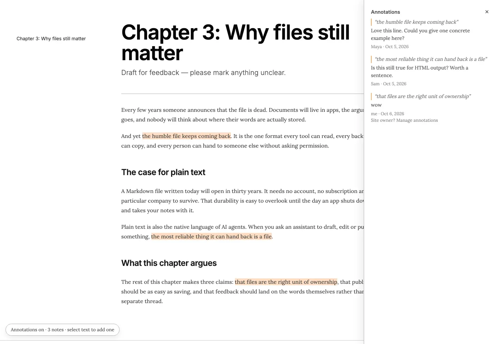
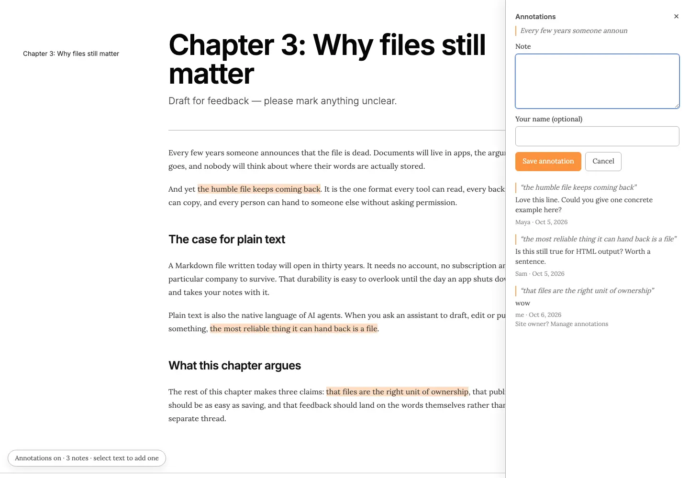
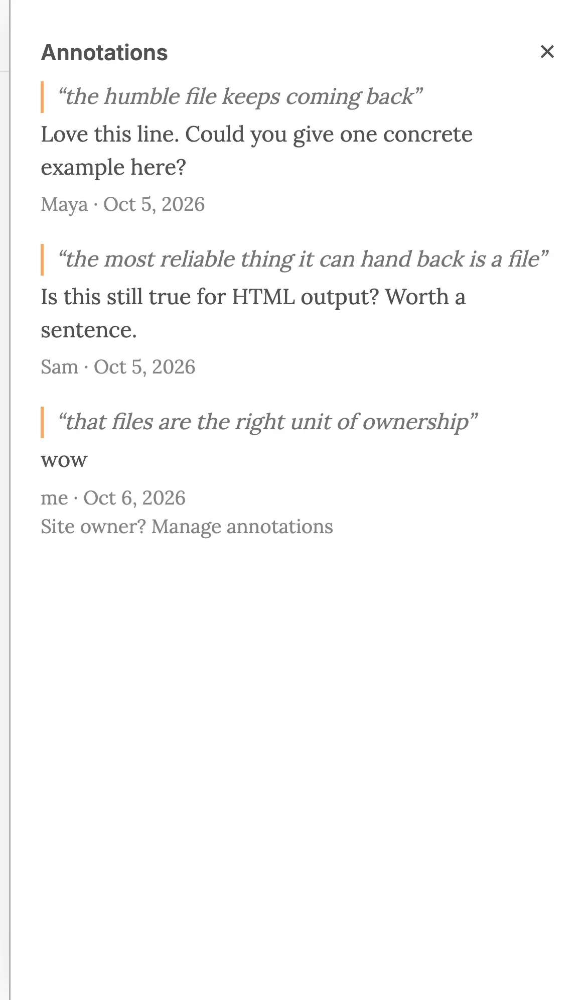

# Annotations v2: UI refresh (stream A) and replies (stream B, later)

Status: **Draft for Rufus's review, revised 2026-10-18 after his feedback.** No code yet. Epic `flowershow-1pr`. Stream A = `flowershow-1pr.10` (now). Stream B = `flowershow-1pr.11` (later, job stories first). Owner/login on site pages = spike `flowershow-1pr.12` (separate). Builds on [Phase 0](2026-10-03-page-annotation-phase-0-implementation.md) and [ADR 0015](../adr/0015-annotations-are-open-and-moderated-off-page.md).

Two streams:

- **Stream A: UI refresh.** What the annotate affordance looks like, where notes render, phone behaviour. Same data and API as Phase 0. Small, ship first.
- **Stream B: replies and resolving.** A new feature area. Start from job stories, copy the best (Google Docs), start simpler than that. Not designed yet.

The dashboard is out of scope for both.

## 1. Today (Phase 0)

One client component (`apps/flowershow/components/public/annotations/page-annotations.tsx`, styles in `apps/flowershow/styles/annotations.css`): a fixed pill at bottom left, a floating "Annotate" button on selection, highlights via the CSS Custom Highlight API, and a fixed 24rem right panel listing every note.

Screenshots from annotations-demo-rufuspollock.flowershow.me (2026-10-18):

| Desktop 1440, panel open | Desktop 1440, writing a note | Phone 390, panel open |
|---|---|---|
|  |  |  |

Problems with the UI:

1. **Weak, odd entry point.** "Annotations on · 3 notes · select text to add one" is a pill in the bottom-left corner, where nobody looks, sharing the bottom edge with "Built with Flowershow" and report-abuse. A reviewer sent the link may not notice the page is open for feedback at all.
2. **Panel covers the text** (`flowershow-1pr.8`). At 1440px the fixed panel hides the end of every body line; the right TOC column it sits over is free space we could use instead.
3. **Notes are far from their passage.** The list is in document order at the top of the panel; you match quote to highlight by reading. Clicking a highlight does not reliably bring its note into view.
4. **Heavy composer.** Writing a note pushes the list down; the form ("Note", "Your name (optional)", big orange "Save annotation") is heavy for the one-line notes people write.
5. **Phone panel hides the page.** It is a full-height side sheet, so you can't see the passage while reading its note.
6. **Chrome noise.** "Site owner? Manage annotations" sits in every panel; author and time are faint grey ("me · Oct 6, 2026").
7. **a11y gaps** from `flowershow-1pr.6`: focus not returned on close, `aria-controls` pointing at a missing element, Annotate button can render off-screen.

## 2. How the best do it

| Product | Entry affordance | Where notes render (desktop) | Phone | Count shown |
|---|---|---|---|---|
| Google Docs | Comment icon floats in the right margin beside the selection; "+" in toolbar; Ctrl+Alt+M | Cards in the right margin, aligned to their passage; active card shifts others | App: comments open as a bottom panel / full-screen thread | Comments icon in the top bar opens "All comments" |
| Claude artifacts (claude.ai / Claude Science) | Artifact header bar at top holds the actions; select text → small **Comment** button; HTML needs a **Comment** toggle in the header first | Highlight badge inline, hover to read; no threads, no resolve | Same, in the artifact view | Pending comments listed above the message box |
| Notion | Selection toolbar "Comment"; top-bar comments icon | Inline comments in the right margin on wide pages; top-bar icon opens a sidebar with all/resolved | Bottom sheet | Small count beside highlighted text; top-bar icon |
| Hypothesis | Selection pops "Annotate / Highlight"; collapsed sidebar tab at right edge | Collapsible right sidebar, pushes or overlays page; "bucket bar" arrows with counts in the gutter | Sidebar goes full-width over the page | Count on the sidebar tab and bucket bar |
| Medium | Selection menu: Highlight / Respond / Share | Responses in a right drawer that overlays; highlights inline | Bottom sheet | Speech-bubble + count in the article action bar (top and bottom) |
| Figma | Comment mode toggle in the top toolbar (C) | Pins on canvas, list in a right panel | App: pins + sheet | Badge on the comment tool |

What they share: (a) a **persistent, visible entry at the top** (toolbar/header) showing a count, (b) a **contextual button on selection**, (c) notes in a **right margin or panel that does not cover the text** on desktop, (d) a **bottom sheet** on phones. Margin-aligned cards (Google Docs, Notion) are the premium version; a plain docked list (Notion sidebar, Hypothesis) is the simple one.

Sources: [Claude Science comments](https://claude.com/docs/claude-science/comments), [Hypothesis client config](https://hypothesis-client.readthedocs.io/en/latest/publishers/config.html), [Google Docs Android comments](https://workspaceupdates.googleblog.com/2024/10/redesigned-comments-on-android-docs-sheets-slides.html), [Notion 2.12 comments](https://www.notion.com/zh-cn/releases/2021-09-21); the rest from current product use.

## 3. Stream A: recommended design (simple)

Keep the vocabulary "annotations" / "note" (Phase 0 rule: "comments" means Giscus). Keep all Phase 0 data, API and identity rules.

### 3.1 Top bar (entry point)

When annotations are on for the page, a slim bar (36px) sits directly under the site navbar, sticky at `top: var(--navbar-height)`, full content width. Precedent: the temporary-site banner. It replaces the bottom-left pill.

```
┌──────────────────────────────────────────────────────────────────────────────┐
│ [site navbar]                                                                │
├──────────────────────────────────────────────────────────────────────────────┤
│ ✎ Open for feedback · 3 notes      Select text to add a note    [Show notes] │
└──────────────────────────────────────────────────────────────────────────────┘
```

- Left: state + count. Middle (desktop only): the hint. Right: a toggle button "Show notes" / "Hide notes" (`aria-expanded`, `aria-controls` only when the panel exists).
- Phone: `✎ 3 notes · select text to add one   [Notes]`, same height.
- Muted styling from theme tokens (background `--color-background`, bottom border `--color-foreground-200`); no accent fill.
- Zero notes: "Open for feedback · select text to add a note", no toggle.

### 3.2 Selection button

Keep Phase 0's floating **Annotate** button, clamped to the viewport (`1pr.6`). On touch keep the full-width button above the browser bar (works on first tap). Clicking it opens the panel/sheet with the composer focused.

### 3.3 Desktop panel: docked, never covering text

```
 sidebar      page body (#mdxpage)                         notes panel (320px)
 ────────  ───────────────────────────────────────────   ┌──────────────────────────┐
           And yet [the humble file keeps coming back].  │ Notes (3)             ✕  │
           It is the one format every tool can read…     │ ──────────────────────── │
                                                         │ “the humble file…”       │
           Plain text is also the native language…       │ Love this line. Could    │
           something, [the most reliable thing it can    │ you give one example?    │
           hand back is a file].                         │ Maya · 2 days ago        │
                                                         │ ──────────────────────── │
                                                         │ “the most reliable…”     │
                                                         │ Is this still true for   │
                                                         │ HTML output?             │
                                                         │ Sam · 2 days ago         │
                                                         └──────────────────────────┘
```

- **Docked in the right column**, below the top bar, replacing the TOC while open (TOC hidden, not moved). If the space right of `#mdxpage` is under 320px, the page body gets `margin-right: 320px` (push, not overlay). Text is never covered, closing `1pr.8`.
- **List in page order**, quote as a short one-line excerpt. **Linked both ways:** click a highlight → panel opens if closed, its note scrolls into view and is outlined, highlight switches to a stronger "active" style; click a note → page scrolls to its highlight.
- **Composer at the top of the panel** when active: quote excerpt, one textarea ("Add a note…"), "as Maya · change" line (name asked inline the first time only), small "Post" button; ⌘/Ctrl+Enter posts, Esc cancels. List stays in place below.
- **Author and time** in normal text weight, relative time (`Intl.RelativeTimeFormat`, full date in `title`).
- **Outdated notes** (quote not found) grouped at the bottom under "Not found on page (N)", collapsed. Resolved notes stay where Phase 0 has them (collapsed "Resolved (N)").
- "Site owner? Manage annotations" moves to a small footer link at the bottom of the panel.
- Panel open/closed remembered per site in `localStorage` (try/catch). Default: closed, so the reader sees the page first and the top bar invites them in.

### 3.4 Phone: bottom sheet

```
┌──────────────────────────┐   ┌──────────────────────────┐
│ ✎ 3 notes      [Notes]   │   │ ✎ 3 notes      [Notes]   │
│ And yet [the humble file │   │ …the humble file keeps…  │
│ keeps coming back]. It   │   │ ──────────────────────── │
│ is the one format every  │   │ ▁▁▁                      │
│ tool can read…           │   │ Notes (3)             ✕  │
│ ──────────────────────── │   │ “the humble file…”       │
│ ▁▁▁                      │   │ Love this line. Could…   │
│ Maya · 2 days ago        │   │ Maya · 2 days ago        │
│ Love this line. Could…   │   │ “the most reliable…”     │
│ ‹ 1 of 3 ›            ✕  │   │ Is this still true…      │
└──────────────────────────┘   └──────────────────────────┘
  tap highlight: peek (~35%)     tap [Notes]: list (~70%)
```

- Tap a highlight → sheet at **peek** height with that note, passage still visible above; ‹ › steps through notes and scrolls the page to each highlight.
- Tap [Notes] → sheet at ~70% with the full list. Annotate → sheet at ~70% with composer focused, page scrolled so the selection sits above the sheet.
- `role="dialog"`, focus moved in and returned to the trigger on close; Esc and swipe-down close. `env(safe-area-inset-bottom)` and `visualViewport` keep the composer above the iOS keyboard.

### 3.5 Alternatives (not recommended for now)

- **A. Google Docs margin cards.** Each note as a card aligned to its highlight's height, active card pushes neighbours. Best reading experience, but a layout engine (recompute on resize, font load, DOM changes; collisions) roughly doubles the desktop work. Good follow-up once the docked panel ships; the panel's linking makes it an incremental step.
- **B. No bar, just a better floating control.** Keep a bottom control but move it to a labelled tab at the right edge (Hypothesis-style). Cheaper, but stays easy to miss and still competes with "Built with Flowershow" and report-abuse.

## 4. Stream A: PRs

| # | PR | Scope | Acceptance criteria | Effort |
|---|---|---|---|---|
| A1 | Top bar + docked desktop panel | Split `page-annotations.tsx` (anchoring hook, `TopBar`, `NotesPanel`, `NoteItem`); top bar replaces pill; docked panel replaces TOC / pushes body; two-way highlight ↔ note linking with active highlight style; lighter composer + inline name prompt; relative times; outdated group; footer manage link; `1pr.6` a11y (focus return, `aria-controls`, clamped button) and short-quote anchoring fix | At 1024/1280/1440/1920 no body text is covered with the panel open; bar visible and sticky under the navbar on every annotated page, absent when annotations off; clicking a highlight shows its note and vice versa; keyboard-only: open panel, post a note, close, focus back on trigger; Phase 0 unit tests updated and green; e2e for subdomain, custom domain and password site still green | ~8 h |
| A2 | Phone bottom sheet + docs/changelog | Peek/expanded sheet, ‹ › stepping, composer above keyboard, dialog focus; `docs/reference/annotations.md` and site docs updated; changelog entry with 1440px screenshot | Pixel 7 and iPhone 13 Playwright: tap highlight → peek shows that note with passage visible; Annotate works on first tap and posts with keyboard open; manual check on iOS Safari and Android Chrome; changelog per house style | ~5 h |

Order: A1 → A2. Both ship behind the existing per-site annotations setting; no migration, no API change.

## 5. Owner / logged-in viewer (spike `flowershow-1pr.12`)

Findings: [2026-10-18-site-owner-session-spike.md](2026-10-18-site-owner-session-spike.md). Today a site page does not know who is viewing it: the session cookie is scoped to `.flowershow.app`, so it never reaches `*.flowershow.me` or custom domains, and the overlay calls the API anonymously. Recommended: a redirect handshake ("View as owner" from the dashboard or "Sign in as owner" on the site) that issues a short-lived, site-scoped cookie, with the page fetching `{isOwner}` after load so HTML stays cacheable. Stream A assumes no owner detection; once the handshake exists it can add owner-only controls to the top bar (e.g. "Manage", "Turn off"), and stream B can use it for author badges and who may resolve.

## 6. Stream B (later): replies and resolving, job stories first

Replies are a new feature area (`flowershow-1pr.11`, blocked on A). Before any design, agree the job stories, then copy the simplest proven pattern (Google Docs threads: flat replies, one Resolve button, resolved hidden behind a filter) and cut it down.

Draft job stories:

1. **Reviewer answers back.** When the author replies to my note asking what I meant, I want to answer on the same note, so the conversation stays next to the passage and doesn't move to chat.
2. **Author responds without editing.** When a note is a question or I disagree with it, I want to reply on the page ("kept as is because…"), so the reviewer knows it was seen and why nothing changed.
3. **Reviewer closes their own point.** When I reread the page and see my point addressed, I want to mark the note resolved, so the remaining open notes are the ones that still matter.
4. **Agent closes the loop.** When my agent has pulled notes, edited the Markdown and republished, I want it to resolve each handled note with a one-line "what I changed", so reviewers see what happened without diffing the page.
5. **Author triages what needs attention.** When I come back to a page after a few days, I want to see which notes are new or have an unanswered reply, so I deal with those first.
6. **Second reviewer agrees.** When someone has already made the point I was going to make, I want to add "+1, same here" to their note, so the author sees weight without duplicate notes.

Prior draft (2026-10-18, first version of this doc), **not agreed, input only**: a separate `AnnotationReply` table rather than `parentId` on `Annotation`; on-page resolve/reopen by anyone with delete staying owner-only (a reversal of ADR 0015's owner-only resolve); `fl annotations reply <id> -m`, `resolve <id> -m`, `reopen`; threads as the unit in `fl annotations pull` with each reply as one JSON line inside the untrusted wrapper; an "Author" badge only for replies posted with the owner's token. See commit `948052a1` for the full text.

## 7. Out of scope (both streams for now)

Dashboard changes, email/notifications, realtime updates, edit/delete own note, @mentions, reactions, rich text in notes, annotating images/canvas/HTML pages, rate limiting beyond caps.

## 8. Open questions for Rufus

Stream A:

1. **Top bar under the navbar, sticky** on desktop and phone (36px), replacing the pill. OK, or non-sticky on phones to save space?
2. **Wording:** "Open for feedback · 3 notes" and "notes" in the UI, keeping "comments" for Giscus. Or switch the UI to "comments" like everyone else?
3. **Docked panel first, margin-aligned cards later** (alternative A). OK to start with the list?
4. **Panel closed by default**, opened from the bar or by clicking a highlight. Or open by default when a page has notes?

Stream B:

5. Are the six job stories the right set? Any to drop for v1 (6 looks optional; 4 matters most for the agent loop)?
6. Who may resolve: anyone on the page, the original reviewer only, or the owner only? Depends on the `1pr.12` spike.
