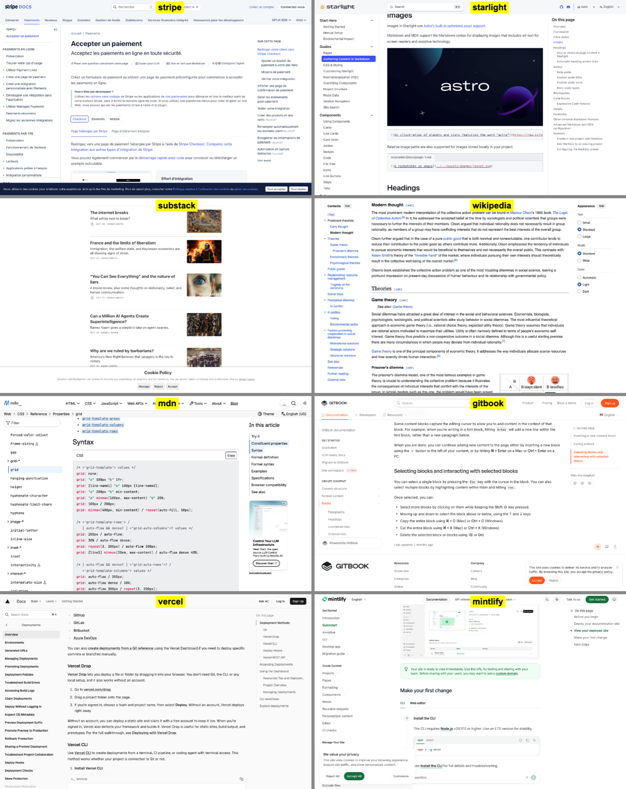

# Page TOC and site navigation layout: survey

**TL;DR:** Almost every docs site puts the site nav on the left and the page TOC on the right; the left-TOC exceptions (Wikipedia Vector 2022, Substack, Claude, Anthropic research, gwern) are pages with no site sidebar to compete with, so moving the TOC left and the site sidebar right would be unconventional.

**Checked by screenshot (1440px, 2026-11-07):** Stripe, Starlight, MDN, GitBook, Vercel and Mintlify docs all put the site nav on the left and the page contents on the right (six out of six). Wikipedia (Vector 2022) puts the contents on the left, with the main menu hidden behind a button and an "Appearance" panel (text size, width, colour) on the right. The Substack check failed (the link opened the home page), so Substack stays unverified.

Evidence key: **V** = verified this session (fetched page, release notes or official docs); **N** = from Rufus's ux-patterns notes; **M** = from memory, not re-checked today. Page fetches return text, not rendered layout, so most placement facts are M. Treat M rows as likely, not certain.

## Table

| Site | Page TOC position | TOC style | Site nav position | When both exist | Phone | Reader can switch layout | Evidence |
|---|---|---|---|---|---|---|---|
| Stripe docs | Right | Full list, current highlighted | Left | Three columns, code in the third on API pages | Nav behind menu button; TOC hidden | No | N (three-column), M (rest) |
| Tailwind docs | Right | Full list, current highlighted | Left | Three columns | Hamburger for nav; TOC hidden | Light/dark only | M |
| MDN | Right ("In this article") | Full list, sticky | Left (section tree) | Three columns | Both collapse into menus; TOC becomes a dropdown near the top | No | V (both exist, in source order), M (placement) |
| React.dev | Right ("On this page") | Full list, current highlighted | Left | Three columns | Nav in a hamburger; TOC hidden | No | M |
| Next.js / Vercel docs | Right | Full list | Left | Three columns | Nav in a menu; TOC collapses to a dropdown | No | M |
| GitHub docs | Right ("In this article") | Full list | Left | Three columns | Collapsed into menus | No | M |
| Linear docs | Right (when present) | Full list | Left | Quiet, minimal | Menu | No | N (minimal), M (placement) |
| Starlight (Astro) | Right ("On this page") | Full list | Left | Three columns | Hamburger for nav; "On this page" as a top dropdown | No | V (both exist), M (placement, mobile) |
| Docusaurus | Right | Full list | Left | Three columns | Nav in a drawer; TOC hidden | Light/dark only | M |
| Nextra / Mintlify / GitBook | Right | Full list | Left | Three columns | Menu for nav; TOC hidden or dropdown | No (GitBook lets the author hide the TOC) | M |
| Quartz (default) | Right (TOC component) | Collapsible list | Left (explorer, search) | Left explorer; right graph, backlinks, TOC | Both sidebars go horizontal and stack in the page below 800px | Author configures layout in code | V (sidebar split and breakpoints), M (TOC placement) |
| Obsidian Publish | Right | Full list ("Outline") | Left (file nav) | Left nav; right outline, graph, backlinks | Collapsible panels | Reader can collapse panels | M |
| Wikipedia, Vector 2022 | Left, sticky, beside the article | Full list; sub-sections collapsed on long articles; can collapse into the article title | Main menu in a collapsible left menu | Both live in the left column; TOC is the sticky part | Separate mobile skin, no TOC; sections collapse | Yes: other skins selectable; menus can be pinned or hidden | V (design doc: TOC beside article, sticky, not inline), M (mobile skin) |
| Substack posts | Left | Dash/tick rail; click opens outline | None on the post page | Not applicable | Desktop only | No | V (writers' reports from Oct 2024; no official note found) |
| Notion pages | Right, not left | Floating outline, appears on hover at the right edge; only with headings | Left app sidebar (workspace tree) | Left tree, right floating outline | Unknown | Toggle per page (M) | V (release notes: "hover over the right side"), M (rest) |
| Claude app previewer | Left | Tick rail sized by heading level; hover opens full outline | None | Not applicable | No contents at all | No | N (Rufus's detailed notes) |
| Anthropic research | Left sidebar on desktop; slim "chapter bar" at top | Full list; bar shows current section and opens contents | None | Not applicable | Chapter bar | No | N (note tags "sidebar-toc" and chapter bar) |
| gwern.net | Left sidebar on desktop (sticky, nested); box in the page on mobile | Full nested list | None (header links only) | Sidenotes in the right margin, TOC left | TOC becomes the inline box | Yes: reader mode, dark mode, collapse toggles (M) | N (contents box beside the opening), M (sidebar) |
| Distill / transformer-circuits | Inline at the top or left | Full list | None | Figures and margin notes on the right | Inline | No | N (contents), M (placement) |
| Ink & Switch essays | Inline at the top | Full list | Site header only | Not applicable | Same | No | N |
| Works in Progress | Inline contents list | Full list | Site header only | Not applicable | Same | No | N |
| Andy Matuschak notes | None (sliding panes) | Links are the navigation | Panes slide, no sidebar | Not applicable | Panes stack | No | N |
| Maggie Appleton | Mostly none; long essays may show a list | List near the top | Site header | Not applicable | Same | No | N (garden style), M (TOC) |

## Patterns

- **Docs convention is fixed.** Site nav on the left, page TOC on the right, content in the middle. Stripe, Tailwind, React, MDN, GitHub, Starlight, Docusaurus, Nextra, Mintlify and GitBook all do this (mostly M). I found no site that puts the site tree on the right.
- **The left TOC appears when there is no site tree.** Wikipedia, Substack, Claude, Anthropic research and gwern.net have one navigation element on the page, the TOC, and the left gutter is free. The left is where the eye lands first, so the outline takes it.
- **Wikipedia is the main precedent, and it is partial.** Vector 2022 moved the TOC from inline to a sticky column beside the article (V). It also moved the main menu into a collapsible left menu, so the left holds both. Nav did not go right. Readers can still pick another skin.
- **The tick rail is not a settled side.** Claude and Substack put it left; Notion's hover outline sits right (V). It costs almost no width, so it can live in either gutter. It is a different thing from a full TOC list.
- **Phone: the TOC is the first thing dropped.** Docs sites hide the page TOC or make it an "On this page" dropdown at the top. Site nav goes into a hamburger or drawer. Claude's previewer shows no contents on phones. Quartz stacks both below the content. I found no site that shows a rail on a phone.
- **A left tree plus a left rail at once is rare.** Wikipedia collapses the menu behind a button and keeps the TOC sticky. Notion's workspace tree can be hidden. Quartz's explorer is collapsible.
- **Readers rarely get layout choice.** Light/dark is common. Moving the TOC or nav is not, apart from Wikipedia skins, gwern's reader toggles and collapsible panels in Obsidian Publish and Notion. Authors choose.
- **Essay sites mostly inline the TOC or skip it.** Ink & Switch, Works in Progress and Maggie Appleton keep one calm column. Contents is a list near the top, not a persistent widget.

## Implications for Flowershow

- **Page TOC left or right:** Right stays the safe default for sites with a sidebar, because it matches docs convention and reader habit. A left tick rail is defensible on pages without a site sidebar, where it matches Claude, Substack, Wikipedia and Anthropic.
- **Where the site sidebar goes if the page TOC is on the left:** Nowhere good. Sidebar on the right has no precedent in this survey and breaks docs muscle memory. If a left tick rail is wanted, keep the sidebar left and make it collapsible (the Wikipedia move) so the rail is alone in the gutter, or show the rail only when the site has no sidebar.
- **Presets vs free movement:** Offer a few named presets, not freely movable parts. Suggested: "Docs" (sidebar left, full TOC right, the default), "Essay" (no sidebar, tick rail left, outline on hover), "Garden" (sidebar left, TOC and backlinks right). Free movement is rare in the wild and multiplies layouts to test.
- **Phone:** Hide the rail. Keep an "On this page" dropdown or button at the top for the TOC and a hamburger for the sidebar, as Starlight, MDN and Wikipedia mobile do.
- **Reader switching:** Not needed at first. If added, make it a small toggle (hide sidebar, hide TOC), as Wikipedia and Notion do, not a layout picker.
- **Gap to close:** Placement facts for most docs sites are from memory. Before deciding, check Stripe, Starlight, gwern.net and Substack live in a browser at desktop and phone widths.
