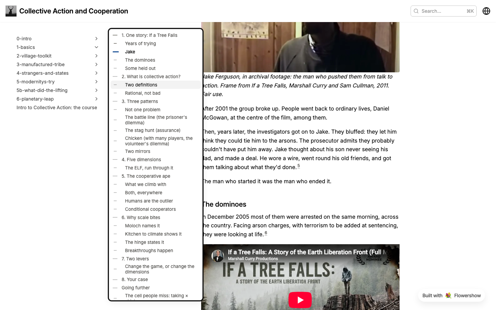

# Page contents as a tick rail

**TL;DR:** Build the Claude-style tick rail into Flowershow as a second style for the page contents (`toc: { style: "rail" }`). It replaces the "On this page" panel **in the same place, on the right**; the site sidebar stays on the left. On phones the contents becomes a collapsible "Contents" block under the page title. It starts as an opt-in setting so we can try it, with the aim of making it the default rather than keeping yet another option. A left-hand rail belongs to a separate layout question (site layouts beyond themes), tracked on its own.

Survey behind this: [2026-11-07-toc-layout-survey.md](2026-11-07-toc-layout-survey.md).

## Why

- Rufus wants the page contents the Claude doc viewer and LessWrong have: a column of small ticks, one per heading, with the current one highlighted; hovering opens the outline. It costs nothing visually until you reach for it, and it doubles as a progress marker.
- Today Flowershow's contents is a permanent right-hand panel ("On this page"), 240px wide. It is shown only at 1280px and up, and phones get nothing.
- The Collective Action course site (collective-action.seedsofrenaissance.org) already has a rail, through a script (`house.js` in `life-itself/design/research-flowershow-theme/`) plus `!important` overrides of Flowershow's grid. It puts the rail on the left, between the sidebar and the text, and its outline opens over the text (screenshot below). Rufus's view: a left rail next to a site sidebar is bad UX, and no site with a rail does it.
- The rail is narrower than the panel, so the text gets more room on the right.



## Goals

- A tick rail as a built-in, server-rendered style for the page contents, on any plan, with no script for site owners to add.
- An inline, collapsible Contents block on narrow screens, so phones get a contents too (today they get none).
- Sits where the contents panel sits today (the right column), with or without the site sidebar. At rest it never covers the text; the outline covers part of it only while open, like a menu.
- One switch to turn it on site-wide, overridable per page, like `showToc` today.
- The Collective Action site can delete the rail half of `house.js` and its grid overrides.

## Non-goals

- Moving the site sidebar to the right, or a left-hand rail. A left rail only makes sense in a layout with the site sidebar off (as on LessWrong post pages); that is part of the site-layouts question (follow-ups).
- Freely movable parts (`toc: left|right`, `sidebar: left|right`) in this step.
- Named layouts (reading, wiki, docs). They come next, as follow-up work (below).
- Footnote cards, breakout widths and other items from the research-site style list. They are separate follow-ups.
- Changing the default for existing sites. The panel stays the default until we have tried the rail on real sites.

## Anti-goals

- A rail that is cute but hard to use: it must work by keyboard, with a screen reader, and on touch.
- A layout that shifts or flashes when the rail appears (today's script does this).
- Two copies of the heading logic: the rail and the panel share one source of headings and current-section tracking.

## Design

### Config

Follows the existing `showSidebar` + `sidebar: {...}` pattern:

```json
{
  "showToc": true,
  "toc": { "style": "rail" }
}
```

- `toc.style`: `"panel"` (default, today's right column) or `"rail"`.
- Frontmatter can override per page: `toc: { style: rail }`, as `showToc` can today. (Page frontmatter is the `PageMetadata` type in `server/api/types.ts`; it has no Zod schema.)
- `showToc: false` still turns contents off entirely, whatever the style.
- Added to the site config schema (`lib/site-config-schema.ts`) and to `PageMetadata`, and documented in the docs page for page contents.
- **Which pages:** the rail appears wherever `showToc` resolves to true today: ordinary pages and posts (in a post's narrow column, the rail sits to its right). Listings, changelog timelines and canvas pages keep their current rules.
- **Knowledge graph:** if `showKnowledgeGraph` is on, the right column keeps its full width for the graph, and the rail sits below the graph where the panel sits today.

### Desktop: where the rail sits

- The rail takes the place of the contents panel: the right column of `.layout-inner`, sticky under the navbar, starting level with the first line of the text. The grid keeps its shape (sidebar, text, right column) but the right column narrows to the rail's width (about 3rem), so the text column gets the difference, up to its usual readable measure.
- With or without the sidebar, nothing else changes: the sidebar stays on the left as today.
- The rail is sticky under the navbar and starts level with the first line of the text.
- **Where it doesn't fit:** the rail needs much less width than the panel, so it can show from 1024px (the panel shows only from 1280px). Below that, the inline block (below) takes over. CSS breakpoints on the grid, no pixel-measuring script.
- The comments panel: `annotations.css` rewrites the grid for `.has-toc` and `.has-sidebar-and-toc` when comments open; the new rail grids need matching rules. When comments open, the right column hides as today, and the rail with it.
- Check the result with enlarged text (browser zoom 200%) and with comments open, as well as at normal size.

### The rail at rest

- One short horizontal tick per h2 and h3 heading. Headings come from `TOC_HEADING_SELECTOR` (it matches h2 to h6 and skips listing items); the rail keeps only h2 and h3. (The panel's `collectHeadings` handles only H1 to H3 today and drops deeper ones.)
- Tick length shows level: about 14px for h2, 8px for h3. The current section's tick is longer and in the accent colour; ticks above it (read) are darker than ticks below (unread). Taken from the Claude viewer and `house.js`.
- Shown only on pages with three or more headings. With fewer, there is no rail and no inline block.
- If there are more ticks than fit on the screen, the rail scrolls on its own and fades at the ends. (Auto-scrolling to keep the current tick in view is a later nicety.)

### The outline (hover or focus)

- Hovering the rail, or focusing it, opens the outline: a 16–17rem card anchored to the rail, opening **leftwards, towards the text**, on top of the page (it may cover the end of the lines while open, like a menu, but never at rest). Long titles wrap to two lines, then truncate; each row has its tick beside it; the current row is highlighted.
- Clicking a title jumps to the heading (smooth unless reduced motion), updates the URL hash, closes the outline, and moves focus to the heading.
- **Accessibility** (WAI disclosure navigation pattern): the rail is a `nav` with `aria-label="Contents"`, holding a button (the ticks, with a generous hit area, a visible focus ring and `aria-expanded`) that controls an ordinary list of links. Tab moves through the links; arrow keys are optional. Escape closes and returns focus to the button without reopening it. The ticks themselves are `aria-hidden`.
- **Dismissal** (WCAG 1.4.13): the outline stays open while the pointer or focus is anywhere in the rail or the card, with a short grace delay so the pointer can travel from the ticks to the card; it closes on pointer leave (after the delay), Escape, focus leaving, or a jump.
- Touch devices with a wide screen (an iPad in landscape): tapping the rail opens the outline, and a tap outside closes it.

### Phones and narrow screens: inline block

- A collapsible `<details>` "Contents" under the page header, closed by default, listing the same headings (h2, with h3 indented). As on the course site today.
- Choosing a heading closes the block, then jumps to the heading, allowing for the sticky navbar (`scroll-margin-top`, as headings have today).
- Shown below the desktop breakpoint, with three or more headings, **for both styles**: phones get contents whether the site uses the panel or the rail. Today phones get none. This changes existing sites, but only by adding a closed "Contents" block on phones.

### Building it

- Reuse `table-of-contents.tsx`: split it into heading collection plus current-section tracking (a hook), and two views: `TocPanel` (today) and `TocRail`. Fix current-section tracking, which measures heading positions once and goes stale as images load (use an IntersectionObserver or re-measure on resize). Leave `collectHeadings` nesting as it is.
- **First version: headings collected on the client, as today.** The grid reserves the rail's track from the server-rendered class, so the desktop layout doesn't shift; the rail's ticks fade in. On phones the closed "Contents" block appears after hydration, a one-line shift. Rendering the headings on the server (from the MDX) is a follow-up; it needs the same anchor IDs as the rendered headings.
- Grid: add `has-rail` variants to `.layout-inner` in `styles/default-theme.css` (rail with and without the sidebar; with the graph on, the right column keeps the graph's width and the rail sits above it as the panel does today), plus matching comments-open rules in `annotations.css`. Check the themes that restyle `.layout-inner`: letterpress, lessflowery and superstack in `flowershow/themes`.
- Styling through the theme's CSS variables (accent, ink, borders), so themes and `custom.css` can restyle it.
- Tests: unit tests for heading collection and current section; Playwright checks for the rail visible on desktop, the inline block on phone, no overlap with the text at rest, keyboard open, Tab through the links, and Escape; an axe accessibility scan of the open outline.
- Verify on a throwaway `fl` preview site with a long page, with and without the sidebar, then on the course site once deployed.

### Rollout

1. Ship behind `toc.style: "rail"` (opt-in). Docs page, changelog entry with a screenshot.
2. Switch the Collective Action site to it and delete the rail part of `house.js` and its grid overrides.
3. After a few weeks on real sites, decide whether the rail becomes the default for new sites (a separate decision; existing sites keep the panel unless they opt in).

## Decisions (and why)

- **Rail on the right, where the contents is today; sidebar stays on the left** (Rufus, 2026-11-07). The rail is a new style for the page contents, so it goes where the contents goes. Six docs sites checked by screenshot (Stripe, Starlight, MDN, GitBook, Vercel, Mintlify) all have the nav on the left and the contents on the right. Sites with a left rail (Claude, LessWrong post pages, Substack) have no site sidebar beside it.
- **Comments panel:** when it opens it hides the right column today, and the rail with it. That is fine for this step.
- **Presets built from options, not freely movable parts.** Readers almost never get layout choices (Wikipedia's Appearance panel is the exception), and site owners do best with a few named layouts that each work, as Wikipedia skins and docs frameworks offer. Free placement means testing every combination on every theme. So this step adds one option (`toc.style`), and a later step bundles options into presets (see follow-ups).
- **Phones get the inline block for both styles.** The choice of style shouldn't decide whether phones get contents at all.
- **Opt-in first, aiming for the default.** Rufus would rather have fewer options and good defaults; the option exists so we can try the rail on real sites (starting with the course site), then make it the default and possibly retire the panel.
- **Config name `toc.style`** rather than a new top-level key, matching `sidebar: {...}`. Builder's call, easy to rename before release.

## Follow-ups (beads)

- **Site layouts beyond themes** (own bead, needs thought): should Flowershow offer whole-site layouts that change the page structure, not only the styling? For example an essay or post layout with the site sidebar off and the rail on the left (LessWrong post pages), next to today's docs layout. Includes named presets vs options, and `flowershow-9xp` (blog presets).
- Render the heading list on the server, so the rail and the inline block are there on first paint.
- Footnote cards (from the research-site style list).
- Sidebar: show page titles instead of folder slugs (the course sidebar shows `1-basics`), already `flowershow-ej9`.

## Left to the builder

- Exact tick sizes, gaps, colours and the hover delay, within the description above.
- Whether the heading list comes from the server or the client, as long as nothing shifts on load.
- Breakpoint values.
